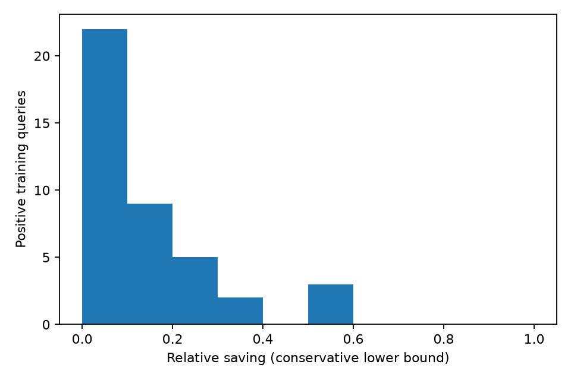

# Bounded Descendant Residual Override (BDRO)

**Outcome: the implemented study reached the prespecified STOP gate. No study
model was fitted, and no fresh confirmatory benchmark was run.**

Implemented and measured on November 1, 2026, Asia/Kolkata. Machine-readable
timestamps use UTC. The canonical base is
`AvniMittal07/learned-icbsh-mapf-final-study`, commit
`625cda82b341906af3df656e2da105970091bd66`. Work is on the local
`bdro-two-day-study` branch; it has not been pushed.

The supplied *Counterfactual Residual Override: Codex-Ready Two-Day Research
Implementation Plan* is the design specification. The scientific question is
whether bounded same-state forced-action continuation supports a conservative
correction to residual conflict selection. This is an interventional continuation
experiment, not a formal causal counterfactual or a claim of research priority.

## What was implemented

All fourteen requested Python files were added. Existing solver code, Model B,
the one-step labels, historical reports and frozen results were preserved.

| Component | Implementation |
| --- | --- |
| Protocol and immutable provenance | `cro_protocol.py` |
| Strict bounded work comparisons | `mapf/downstream_teacher.py` |
| Agent-swap invariant 24-feature wrapper | `mapf/override_features.py` |
| Transparent model inference and probability gate | `mapf/override_policy.py` |
| Parent-only parallel collection and resume | `collect_downstream.py` |
| Independent replay/path/label audit | `verify_downstream.py` |
| Headroom and previous-policy analysis | `analyze_downstream.py` |
| Train-only scaling, fixed logistic and diagnostic Ridge | `train_override.py` |
| Strict official scenario parser | `mapf/movingai.py` |
| Deterministic untouched holdout preparation | `prepare_movingai_holdout.py` |
| Cold four-policy worker and serial final study | `mapf/override_benchmark_worker.py`, `override_study.py` |
| Measured figures and regression tests | `override_figures.py`, `test_counterfactual_override.py` |

The inference boundary only chooses an eligible conflict. It does not prune
branches, replace constraints, change low-level optimality, or replace the
high-level heuristic. Candidate zero remains the existing residual winner.
The existing `candidate_pool()` and `icbs_rollout()` implementations are reused.

## Frozen method and evidence

The input contains 237 saved states and 1,064 candidate conflicts: 199 training
states and 38 validation states. All states retain their original family splits.
No fresh holdout was prepared or read for fitting. The new protocol was frozen
before full collection. A separate five-query smoke campaign validated 18
rollouts and confirmed that resume did not replace completed evidence.

Collection used six processes in a Linux cloud environment with five visible
logical CPUs, Python 3.12.14, and the repository's pinned dependencies. This is
not a timing experiment on the laptop described in the design document.

| Stage | Expansion/wall cap per rollout | New rollouts | Cumulative solved continuations | Strict pairs at stage end |
| --- | --- | ---: | ---: | ---: |
| Q32 | 32 / 0.35 s | 1,064 | 181 | 89 |
| Q128 | 128 / 1.00 s | 872 | 298 | 141 |
| Q512 | 512 / 3.00 s | 755 | 398 | 189 |

There are 2,691 retained rollout records, consuming approximately 2,196.68
process CPU seconds inside the measured rollout calls. Replay, orchestration,
verification and plotting are additional work. Completed candidates were not
rerun at larger budgets. All raw censored evidence remains available.

A solved continuation gives exact CT work. A capped continuation contributes
only its observed expansion lower bound. A completed action wins against a
censored action only if its exact work is strictly below the other's observed
bound. Equality to a bound is unknown. Two censored actions cannot establish
a preference. Larger nominal budgets never become fabricated expansion counts.

The saved-node engine rebuilds a descendant subproblem and recomputes the root
MVC; it does not restore the original search's global OPEN frontier.

## Integrity and test results

The final new-study audit passed:

- 237/237 states replayed with identical candidate pools, residual champions,
  raw features and analytical keys.
- 2,691/2,691 requested first splits were applied.
- 398/398 solved continuations passed independent movement, collision,
  sum-of-costs, saved-constraint and forced-branch checks.
- Completed continuations agreed on solvability and solution cost within each
  state. There were zero replay mismatches and zero invalid solutions.
- Strict pair labels regenerate from raw evidence. Ties and unknowns are
  excluded from the canonical training-pair file.
- All 233 historical tracked files remain byte-identical to the inspected base.

The 36 legacy regression tests passed before additions and again on an isolated
copy of the unchanged historical files. All 32 new unit/integration tests passed
in the actual checkout. They exercise real forced continuations, all four worker
policies, hard timeouts, symmetric features, synthetic model training and JSON
reload, the probability gate, deterministic scenario selection and family-first
statistics. Synthetic test models are temporary fixtures, not study models or
experimental validation results.

The isolated legacy copy is necessary because the old checksum test hashes
every `mapf/*.py`; adding modules changes that membership. No old test or
checksum was weakened or edited.

The separate historical `verify_submission` check did **not** pass exact
reproduction on this Linux machine. Its Model-A bootstrap upper endpoint
recomputes as `1.6345377055628958`, versus the stored `1.634537705562896`, a
difference of `2.220446049250313e-16`. A package-manifest audit also found a stale
entry for `results/FINAL_REPORT.md`; its current hash exactly matches the base
commit but differs from `SOURCE_MANIFEST.json`. These findings are retained in
`legacy_verification_diagnosis.json` and `legacy_manifest_diagnosis.json`.
The original verifier, manifest, statistics and report were left unchanged.
These historical issues are distinct from the passing new-study integrity audit.

## Final downstream evidence

Each state contributes residual-versus-challenger comparisons. There are
827 such pairs at the final stage:

| Split | Challenger better | Residual better | Tie | Unknown | Total |
| --- | ---: | ---: | ---: | ---: | ---: |
| Train | 55 | 117 | 101 | 436 | 709 |
| Validation | 0 | 17 | 8 | 93 | 118 |
| Total | 55 | 134 | 109 | 529 | 827 |

The 529 unknown pairs are not ties or training negatives. Of 2,691 rollout
attempts, 2,277 reached a wall cap and 16 reached an expansion cap; only 398
completed. Approximately 64% of final pairs remain unknown, substantially
limiting inference beyond the resolved subset.

## Headroom decision

An informative training query has at least one supported strict comparison.
A positive query has at least one challenger that strictly beats residual.
Headroom rates below are conditional on informative queries, not on all saved
queries or an independent population sample.

| Frozen data gate | Required | Q512 result | Decision |
| --- | --- | --- | --- |
| Integrity | Zero mismatches/invalid solutions; all splits forced | Passed | PASS |
| Informative training queries | At least 40 | 80 | PASS |
| Positive training queries | At least 20 | 41 | PASS |
| Positive training families | At least 8 | 14 | PASS |
| Positive training maps | At least 2 | 3 | PASS |
| Positive rate among informative queries | At least 15% | 51.25% | PASS |
| Median relative saving among positive queries | At least 10% | **8.7719%** | **FAIL** |

For all 41 selected positive-query winners, both residual and challenger
completed, so their reported savings are **exact**. The implementation also
supports conservative saving lower bounds for censored residuals, but none was
needed for these 41 winners. Median absolute saving was three CT expansions.

The map-stratified family-bootstrap interval for the conditional positive rate
is approximately [35.53%, 67.61%], using 10,000 draws with seed 20261101.
This interval concerns the positive-query rate, not a runtime speedup.

| Training map | Informative queries | Positive queries | Conditional positive rate |
| --- | ---: | ---: | ---: |
| random-32-32-20 | 38 | 16 | 42.11% |
| room-32-32-4 | 18 | 6 | 33.33% |
| warehouse-32-32-aisles | 24 | 19 | 79.17% |

Q128 provisionally passed with 29 positive queries and a median supported
saving of exactly 10%. The larger Q512 evidence increased support but reduced
the median to 8.7719%. The final gate was applied without rounding this up,
changing the threshold, or reverting to the earlier stage.

Consequently `train_override` recorded `trained: false`. No logistic/Ridge
study models, validation predictions, fresh holdout manifest, final schedule,
or final runtime results were created. Their implementation paths were tested
using independent synthetic fixtures, not represented as measured research
results. Official MovingAI downloads were unnecessary after this STOP decision.

## Previous-teacher comparison

Among training states, the old one-step teacher disagreed with residual in
64 cases: 15 challenger wins, 10 residual wins, 10 ties and 29 unknowns under
downstream evidence. Existing Model B disagreed in 70 cases: 18 challenger wins,
9 residual wins, 14 ties and 29 unknowns. These are descriptive, conditional
comparisons over the saved pool, not estimates of online runtime advantage.

Validation states had no supported challenger wins in any residual comparison.
However, 93/118 validation pairs remain unknown, so this is not evidence that
residual always wins or that a classifier would have a known zero success rate.

## Interpretation and limitations

The data demonstrate some local downstream leverage: residual loses on at least
41 of the 199 sampled training queries. They do not establish broad residual
saturation. The typical measured gain among supported positive-query winners
was below the study's frozen practical threshold, which is an engineering
decision rule rather than a universal statistical law.

The sampled states come from existing train/development families on three known
maps. Work is censored by machine-dependent wall budgets and many comparisons
remain unresolved. State-level continuation work is not equivalent to a full
end-to-end solve. No learned predictor or fresh official benchmark was evaluated,
so no generalization, confidence-gated precision, or runtime speedup is claimed.

**No statistically established speedup relative to residual.** Here this means
the confirmatory stage was gated off; it is not a completed runtime test whose
confidence interval crossed one. A future experiment changing the practical
threshold, representation, corpus or budgets needs a separately frozen study.
This result does not justify post-hoc tuning of the delivered campaign.

## Reproduction and artifacts

Read [the exact CLI instructions](results/counterfactual_override/REPRODUCE.md).
To inspect the delivered evidence without collecting new outcomes:

```bash
.venv/bin/python -m unittest -v test_counterfactual_override
.venv/bin/python -m verify_downstream --final
```

The existing output root must not be overwritten. Use a different root for a
separately budgeted repetition. The legacy-regression command retains its
historical artifact-verifier failure rather than substituting a relaxed pass.

Main artifacts under `results/counterfactual_override/`:

- `protocol.json`, `source.json`, `source.zip`, `inputs_manifest.json`:
  frozen source/input provenance and full base revision.
- `rollout_jobs.jsonl`, `rollouts.jsonl`: append-only scheduled and raw evidence.
- `queries_q32.json`, `queries_q128.json`, `queries_q512.json` and corresponding
  `pairs_*.json`: immutable stage snapshots, including unresolved relations.
- `pairs.jsonl`: 189 strict comparisons, retaining train/validation tags.
- `quality.json`, `headroom.json`, `headroom_q128.json`, `headroom_q512.json`,
  `training_decision.json`: independent audit and scientific STOP decision.
- `figures/`: headroom ECDF, relative savings, budget resolution, map-specific
  headroom and previous-policy comparison, exported as PNG and SVG with hashes.
- `evidence/`, `evidence_manifest.json`, `legacy_regressions.*`,
  `legacy_*diagnosis.json`: actual execution logs and historical limitations.
- `smoke/`: a separate correctness/resume campaign, never mixed into the full
  dataset or used as an independent scientific sample.

Protocol SHA-256:
`90439f304e5ce024b57b2ae54878aae7a28b40f4ed45d33ec42f83a1ca35226f`

Generation source SHA-256:
`7da727c21bc88c71ff728672a9ad563f8d96ce32e71d42005148e676422c0654`

Immutable input labels SHA-256:
`a7f9992a837fdc5ccb25b4c602bf21d3a6c5e3bb08a0f4773910bfb375d59d32`


