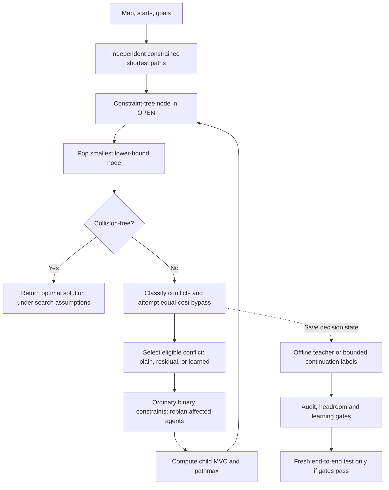
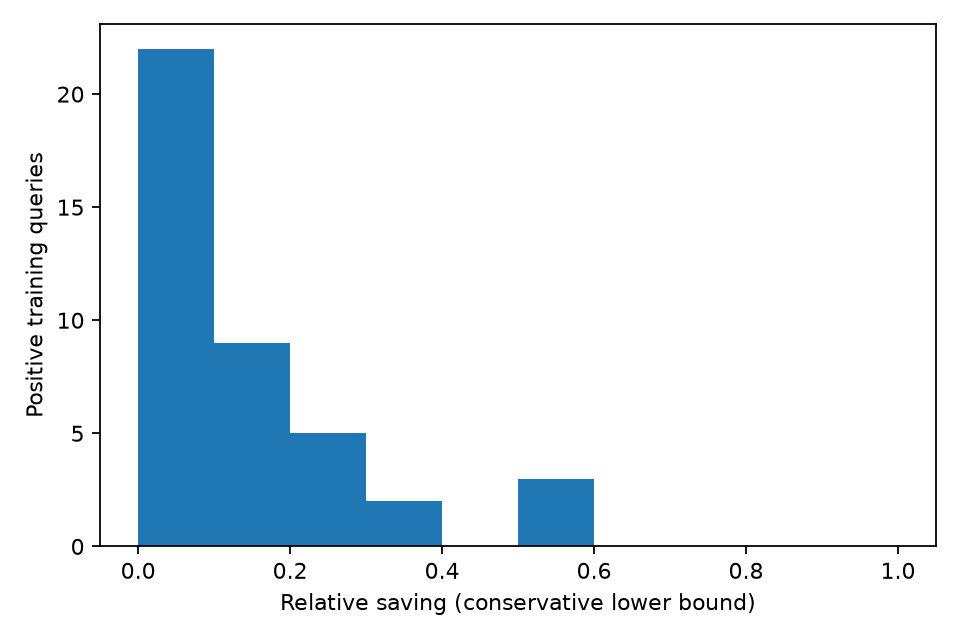

# From MAPF and CBS to learned residual override: a technical explanation of this repository

Prepared November 1, 2026. Scope: the `bdro-two-day-study` branch of
[`anay-28/learned-icbsh-mapf`](https://github.com/anay-28/learned-icbsh-mapf/tree/bdro-two-day-study),
including implementation/results commit `1c0d2cb`. The code base for the new study
came from `AvniMittal07/learned-icbsh-mapf-final-study`, base commit
`625cda82b341906af3df656e2da105970091bd66`. Pushing that study branch into the
anay-28 repository did not merge it into `main`. The branch is essential when
reading this report: the repository's default branch can contain older code and claims.

This is a research prototype for **learning which collision an optimal pathfinding
solver should resolve next**. It is not a neural network that directly plans paths.
Its strongest current contribution is a traceable experiment and an honest
diagnosis of why learning has not yet established a runtime benefit.

The current outcome is precise: the older Model B exists and was evaluated, but
did not establish a speedup over residual selection. The newer BDRO pipeline was
implemented and collected downstream evidence, but stopped before model fitting
because the final median positive-query saving was 8.77%, below a frozen 10%
practical threshold. These are separate experiments with separate targets.

## Reading map

1. Sections 1–6 explain the planning problem and search machinery.
2. Sections 7–11 explain residual selection, features, learning and data generation.
3. Sections 12–16 explain BDRO, its labels, statistics and measured outcome.
4. Sections 17–20 distinguish supported conclusions, defects, limitations and next steps.
5. The final sections map the explanation to files and executable commands.

Mathematical guarantees below describe the algorithms under their stated
assumptions. Passing finite tests supports this implementation; it is not a
universal proof that every possible input is handled correctly.



The diagram summarizes the main split path. A successful bypass can update and
requeue a node before conflict selection; the detailed behavior is in Section 5.

## 1. What problem are we solving?

**Multi-Agent Path Finding (MAPF)** asks how several agents can move through the
same map without colliding. Think of robots moving through warehouse aisles.

Represent the traversable map by an undirected graph

$$G=(V,E).$$

A free cell is a vertex. An edge connects horizontally or vertically adjacent
free cells. This implementation uses a four-connected grid, discrete time and
unit-duration moves. An agent may also wait in its current cell for one step.
It does not model diagonal movement, turning radii, continuous robot geometry,
acceleration or uncertain travel times.

Agent $i$ has start $s_i$ and goal $g_i$. Its finite stored path is

$$\pi_i=(v_i^0,v_i^1,\ldots,v_i^{T_i}),\qquad
v_i^0=s_i,\quad v_i^{T_i}=g_i.$$

Every consecutive pair is either an edge of $G$ or a wait. After the stored path
ends, the agent remains at its goal:

$$v_i^t=g_i\quad\text{for }t>T_i.$$

This **goal persistence** matters: reaching a goal does not make a robot disappear.
A different robot cannot occupy that cell later while the first robot remains there.

Two collision types are forbidden:

- **Vertex collision:** $v_i^t=v_j^t$ for distinct agents.
- **Opposite-direction edge swap:** $v_i^{t-1}=v_j^t$ and
  $v_j^{t-1}=v_i^t$.

Following another agent into a just-vacated cell is permitted when it does not
create one of these collisions. Shared starts or shared persistent goals are
invalid for the supported instances.

The optimization objective is **sum of costs (SOC)**:

$$C(\Pi)=\sum_{i=1}^k T_i.$$

A wait before final arrival costs one, just like a movement. This differs from
minimizing makespan, $\max_i T_i$. A shorter maximum completion time need not
minimize total travel/waiting time.

The code stores cells as **(row, column)**. Official MovingAI scenario files store
coordinates in **(x, y)** order. The parser converts $(x,y)$ to $(y,x)$.
Mixing these conventions can silently produce incorrect experiments on square maps.

## 2. Why not solve everything with one ordinary A* search?

A joint state would be $(v_1,\ldots,v_k,t)$. Each agent has up to five actions,
so a naive joint search can consider up to $5^k$ simultaneous action combinations
per state. Many combinations collide, but the combinatorial growth remains severe.

CBS instead separates two questions:

1. Given individual restrictions, what is each agent's shortest path?
2. Which additional restriction should we introduce to resolve a collision?

This decomposition is useful when agents interact in relatively small parts of
an otherwise large map. It does not eliminate worst-case exponential complexity.

## 3. Low-level search: space-time A*

The low-level planner solves one agent's problem under that agent's constraints.
Its state is $(r,c,t)$, not just $(r,c)$, because a cell may be forbidden at one
time and allowed at another.

A vertex constraint forbids $(r,c,t)$. An edge constraint forbids a transition
$(r_1,c_1)\rightarrow(r_2,c_2)$ whose arrival time is $t$.
`ConstraintSet` stores these in sets for efficient membership checks.

For a state reached at time $t$, the path cost so far is $g_{LL}=t$. A* orders
states using

$$f_{LL}(v,t)=t+d_G(v,g_i).$$

Here $d_G$ is the exact **static** shortest-path distance to the goal, computed
once by reverse breadth-first search. Because the static map ignores temporal
restrictions, $d_G$ is a lower bound on constrained remaining cost. It is exact
for the relaxed single-agent spatial problem, not for the constrained problem.

Reverse BFS costs $O(|V|+|E|)$ per distinct goal. Its tables avoid repeatedly
discovering that Manhattan distance is misleading around walls. They do not
eliminate all search plateaus or all temporal difficulty.

The low-level priority tuple also supports a conflict-avoidance tie count, then
heuristic/time/coordinate/insertion tie-breaks. Such tie-breaks must remain
secondary to the shortest-path objective. A conflict-avoidance table is not a
hard reservation table: other agents' provisional paths do not become mandatory
obstacles unless represented by constraints.

### 3.1 Why reaching the goal is not enough

Suppose the agent reaches its goal at time 4 but has a constraint forbidding
that goal at time 7. Returning the path immediately would violate persistence.
The goal test therefore checks future goal-related vertex and waiting-edge
constraints before accepting permanent arrival.

### 3.2 Finite horizon and unknown outcomes

Let $T_C$ be the latest constraint time and $R$ the set of cells connected to
the goal. After the last restriction, any reachable position needs at most
$|R|-1$ steps along a simple path. The implementation derives the complete bound

$$T_{\mathrm{complete}}=T_C+|R|-1.$$

If a caller supplies a smaller horizon and no path is found, the code raises
`HorizonExceeded`; it does not pretend the agent is infeasible. Likewise, a
deadline expiry is an unknown result. Confusing resource exhaustion with
infeasibility would compromise the higher-level solver.

### 3.3 Caching

Low-level results are memoized using agent identity and immutable constraint-set
keys. Classification also includes horizon information in its cache key. These
caches are scoped to a solve/context where map, starts and goals are fixed;
reusing them across unrelated instances would be unsafe. Not every call site
uses an identical key shape, which can reduce cache hits without by itself
establishing an incorrect result.

## 4. CBS: the constraint tree

A CBS high-level node is conceptually

$$N=(\mathcal C,\Pi,g),\qquad g=\sum_i |\pi_i|-k.$$

The path-length expression counts moves because each stored path includes its
initial cell. Under $\mathcal C$, each individual path is shortest; the joint
collection can still contain collisions.

At the root there are no additional collision restrictions. Compute independent
shortest paths. If they are collision-free, their SOC is globally optimal.
Otherwise select a collision and create two children.

For a vertex collision between agents $i,j$ at $(v,t)$:

$$\mathcal C_L=\mathcal C\cup\{i\text{ cannot occupy }(v,t)\},$$
$$\mathcal C_R=\mathcal C\cup\{j\text{ cannot occupy }(v,t)\}.$$

Replan only the restricted agent in each branch. Edge conflicts similarly
produce two restrictions on the agents' respective directed transitions.

Every valid solution must satisfy at least one branch restriction: both agents
cannot perform the original colliding actions. The branches may overlap; this
is **ordinary binary splitting**, not disjoint splitting.

Plain CBS explores nodes by a lower bound on possible SOC. Under exact
low-level search and correct branching, changing which collision is selected
does not change which feasible solutions the tree can represent. It changes
how much work is required to find an optimal solution.

### 4.1 A tiny example

Two agents move toward each other along the middle row of an open grid. Their
independent shortest paths collide in the center. One branch forces the first
agent to avoid that center at the collision time; the other restricts the second.
The low-level planner may find a wait or a detour. Additional collisions can
remain and require more branching. A conflict-free child's SOC is not sufficient
to return it immediately if a cheaper lower-bound node remains in OPEN.

## 5. ICBS improvements used here

The repository's ICBS-h variant adds cardinality priority, bypassing, a cardinal
graph/MVC heuristic, pathmax and caching. The name does not mean it implements
every enhancement ever published under ICBS or modern CBS variants.

### 5.1 Cardinal, semi-cardinal and non-cardinal conflicts

For a conflict $c$ involving $i,j$, compute the two optimal restricted paths and
their cost increases:

$$\Delta g_i(c)=\ell_i^{\mathrm{restricted}}-\ell_i,\qquad
\Delta g_j(c)=\ell_j^{\mathrm{restricted}}-\ell_j.$$

- Cardinal: both increases are positive.
- Semi-cardinal: exactly one is positive.
- Non-cardinal: both are zero.

A proven infeasible branch has infinite cost. Internally some feature fields
use large sentinels; that representation must not be confused with a measured
finite cost. Classification here uses actual constrained replanning, not an
MDD-width test. Both can inform cardinality, but their computational costs differ.

Why prioritize cardinal conflicts? Resolving either side forces cost progress,
whereas many non-cardinal conflicts can be repaired without increasing SOC.
This is an efficiency policy, not a proof that every cardinal-first sequence
minimizes total search effort.

Selectors receive conflicts from the highest currently permitted tier. The
supported learned policies rank inside that tier, preserving the tiering rule.

### 5.2 Bypassing

Sometimes one restricted alternative has exactly the old path cost and produces
fewer collisions. The solver can replace the provisional path while retaining
the parent's constraints. It avoids committing to the extra restriction just
to select a better equal-cost representative.

The implementation checks equal cost and strict collision-count improvement,
recomputes contextual information, and bounds consecutive bypass steps by a
multiple of the number of agents. Bypassing reduces work on some instances;
reclassification and feature-count updates still cost time.

### 5.3 The high-level heuristic

Build a graph $G_{CF}$ with one vertex per participating agent and an undirected
edge for every cardinally conflicting agent pair. Multiple cardinal conflicts
between the same pair contribute one graph edge.

Every such edge requires at least one endpoint agent to increase its individual
cost in a valid resolution. Therefore the set of agents whose costs increase
must cover every edge. A minimum vertex cover provides the lower bound

$$h_{CG}(N)=\tau(G_{CF}),$$

where $\tau$ denotes minimum vertex-cover cardinality. Since costs are integral,
one increased agent contributes at least one unit. This bound need not capture
the entire extra cost: one agent may need several extra steps, and non-cardinal
dependencies can matter later.

Examples: a star graph has cover size 1; a three-agent triangle has cover size 2.
The heuristic counts unavoidable extra cost, not simply the number of conflicts.

### 5.4 Exact MVC algorithm

The implementation uses branch-and-bound. For a chosen high-degree vertex $v$,
every cover either includes $v$, or excludes it and must include all neighbors:

$$\tau(G)=\min\left(1+\tau(G-v),\; |N(v)|+\tau(G-N(v))\right).$$

A greedy matching gives a lower bound: distinct matching edges require distinct
covering vertices. Branches unable to improve the incumbent are pruned.
MVC is NP-hard on general graphs; exactness does not imply cheap evaluation.
Small conflict graphs and caching make the approach practical for this prototype.

### 5.5 Pathmax and OPEN ordering

The high-level priority is $f=g+h$. Child heuristics need not behave monotonically,
so the code applies

$$h_{\mathrm{eff}}(N')=\max\{h_{CG}(N'),f(N)-g(N')\},$$
$$f(N')=\max\{g(N')+h_{CG}(N'),f(N)\}.$$

The inherited parent lower bound remains valid for a more constrained child.
This is a bound-propagation operation, not a change to actual path cost.
Further OPEN tie-breaks use heuristic and cached conflict/node information.
All else equal, tie-breaking can materially change the expansion count.

## 6. What is *not* implemented by this name?

The supported study does not implement a full modern optimized CBS enhancement
stack: meta-agent merging/restart, weighted dependency graphs, extensive
rectangle/corridor/target reasoning, mutex reasoning and genuine disjoint
splitting are not all provided by this local variant.

In particular, the historical alias `disjoint_splitting_selector` points to a
degree-based selector. Selecting a high-degree conflict does not implement
positive/negative disjoint constraints. The code comments acknowledge this.

A direct runtime comparison with an optimized solver such as CBSH2-RTC would
compare far more than conflict choice. It could be a useful external reference,
but not a controlled measurement of our selector alone.

## 7. The strong analytical baseline: residual selection

For each candidate and each incident agent $a$, remove that agent's incident
edges from the current cardinal graph and calculate

$$h_{-a}=\tau(G_{CF}-a).$$

Changing only agent $a$ leaves the other agents' paths and constraints unchanged.
The nonincident cardinal edges supply a residual lower bound for that child.
Combine it with the cached restricted-path increase:

$$b_a=\Delta g_a+h_{-a}-h_{CG}(N).$$

This bounds raw child-bound progress relative to the parent's **raw CG bound**.
It is not the exact recomputed child's heuristic or the exact effective progress
after inherited pathmax. The selector's `mvc_size` and `effective_h` are distinct.

The actual code maximizes this lexicographic tuple:

$$K(c)=\big(\min(b_i,b_j),\min(\Delta g_i,\Delta g_j),
\max(b_i,b_j),\max(\Delta g_i,\Delta g_j),
d_i+d_j,\operatorname{pairCount}(i,j),-t\big).$$

Lexicographic means the first differing component decides. The order above is
important: minimum path-cost increase precedes maximum residual-bound progress.
Some informal docstrings summarize this order less precisely than the function.
Exact ties retain stable candidate ordering.

Why these quantities? They favor progress in the cheaper branch, then additional
cost/bound progress, highly connected agents, chronic pairs and earlier conflicts.
These are reasonable deterministic design choices, not a theorem that this tuple
minimizes continuation work.

**“Zero additional A* calls” is the correct claim**, because classification has
already computed alternative paths. Residual MVC computations, dictionary lookups
and tuple construction are not free. Even an accurate learned replacement must
beat the total cost of this already useful baseline.

## 8. Why learn a conflict selector?

Two conflicts may have similar immediate analytical scores but lead to very
different descendant trees. Learning could use spatial and contextual information
to choose a smaller search tree. The hypothesis concerns computational effort,
not improving the optimal SOC beyond the optimum.

Approximate runtime accounting is

$$T\approx n_{CT}\,\overline{T_{CT}}+n_{A*}\,\overline{T_{A*}}
+T_{features}+T_{inference}+T_{startup}.$$

Reducing CT expansions alone does not guarantee reduced runtime: node costs vary,
and extraction/inference can consume the saving. Reducing one-step prediction
error is even further removed from demonstrating a solver speedup.

The model's safe integration boundary is narrow: it returns an eligible conflict
to the unchanged splitter. Incorrect predictions may waste search effort; they
must not delete branches, fabricate constraints, change $h$, or mark timeouts
as infeasible. Resource caps still mean that an otherwise correct search may
fail to finish within the allowed budget.

## 9. The 24 raw features, with implementation caveats

`mapf/features.py` is the authoritative schema. Names describe intentions, but
some values are approximations or encoded sentinels rather than exact semantics.

| Indices (1-based) | Fields | What the implementation supplies |
| --- | --- | --- |
| 1–2 | corridor_score_i/j | Distance transform at conflict-related cells, clipped to 5; walls and borders seed the transform. A bottleneck proxy, not corridor-topology reasoning. |
| 3–4 | local_density_i/j | Other agents within Manhattan radius 2 at collision time, excluding the conflict pair. |
| 5 | pair_conflict_count | Number of previous selections of this pair along the CT branch. Not a global lifetime collision count. |
| 6–7 | goal_dist_i/j | Static reverse-BFS distance from each represented conflict location to that agent's goal; a Manhattan fallback exists for absent entries. |
| 8 | num_agents_in_conflict_graph | Number of nonisolated agents represented in the cardinal graph. |
| 9–10 | cardinal_degree_i/j | Cardinal graph degrees of the two agents. |
| 11–12 | downstream_conflict_count_i/j | Normally cached total collision count after that agent's alternative path; fallback semantics require care. |
| 13 | conflict_type | Cardinal=2, semi-cardinal=1, non-cardinal=0; distinct from vertex versus edge collision type. |
| 14 | mvc_size | Raw current graph MVC. It can differ from inherited effective $h$. |
| 15 | conflict_time | Collision timestep. |
| 16 | is_edge_conflict | Edge-swap indicator. |
| 17–18 | agent_i/j_path_length | Current individual move counts. |
| 19–20 | delta_g_i/j | Restricted-path cost increases, capped at 50; missing alternatives encoded as 50. |
| 21–22 | delta_g_min/max | Minimum/maximum of those encoded increases. |
| 23 | delta_f_res | Minimum encoded increase plus residual MVC change. This feature need not equal an infinite-valued analytical tuple component. |
| 24 | marginal_conflict_delta_min | Minimum collision-count change, with upper clipping/sentinel handling. Negative changes can remain negative. |

Three details deserve attention:

1. For edge collisions the two represented cells are associated with the
   conflicting transition. Agent-label symmetry of raw feature *definitions*
   should not be assumed simply because a feature name contains i/j.
2. Feature extraction's downstream fallback counts conflicts involving the
   replanned agent, whereas the usual cached field represents the total updated
   collision count. In the audited corpus replay checks protect the exact values;
   a future collector exercising fallback paths must examine this difference.
3. Clipping and sentinels collapse distinct cases: an infeasible alternative and
   a very expensive feasible alternative can have the same finite feature encoding.
   That is a representational limitation, not a valid inference of infeasibility.

## 10. Historical learning phases: what actually exists

The repository contains old scripts, recovery work and later audited experiments.
They should not be pooled into one performance claim.

### 10.1 Legacy XGBoost/proxy work

Older files describe XGBoost rankers, proxy labels, ablations and larger claims.
Those artifacts remain for historical inspection. Their presence does not make
them the supported final models or validate every original README assertion.
`README_LEGACY_UNVERIFIED.md` explicitly separates that history.

### 10.2 Model A: small continuation-label study

The supported Model A is a pairwise linear Ridge model with alpha 10 and no
intercept. Its repaired continuation corpus supplied only 27 strict training
pairs from ten informative queries and six families. Its recorded development
family-macro pair accuracy is about 61.11%. This is weak support for a broad
learning claim. The old failed collection gate remains failed; subsequent
exploratory fitting did not retroactively make that gate pass.

### 10.3 Model B: one-step child-teacher imitation

**The supported Model B is also a linear Ridge ranker, not XGBoost.** It imitates
an expensive one-step teacher using a residual-first candidate pool of at most
six eligible conflicts. The teacher constructs ordinary children, replans,
classifies child conflicts, recomputes child MVC and applies pathmax.

For each conflict it prefers the larger lexicographic pair

$$K_T(c)=(\min(F_i,F_j),\max(F_i,F_j)),$$

where $F_a$ is the effective child bound. Larger lower bounds are interpreted
as stronger progress. Equal teacher keys are ties. A proved absent branch is
encoded as $+\infty$; time-capped evaluation is unknown, not $+\infty$.

Model B learns candidate scores $s(c)=w^Tz(c)$, where $z$ is standardized raw
features. For strict within-query pairs the Ridge objective is schematically

$$\min_w\sum_q\sum_{(a,b)\in P_q}\frac1{|P_q|}
\big[w^T(z_a-z_b)-y_{ab}\big]^2+10\|w\|_2^2,$$

with $y_{ab}\in\{-1,+1\}$. The original scaler is fitted on training
**candidate vectors**, before pair differences. The new BDRO scaler instead
uses training **pair-difference vectors**; these are different designs.

Model B used 1,277 strict training comparisons from 182 informative training
queries in 29 families. Its development family-macro pair accuracy was 85.264%.
Tied predictions receive half credit in that metric. This is not SOC accuracy,
solution success rate or the probability of a runtime improvement.

Its frozen final test used 54 instances, 18 families, six policies and two
repetitions: 648 analyzed runs. Against residual, its reported geometric family
runtime ratio was approximately 1.031 with 95% interval [0.972, 1.103]. It solved
74/108 runs versus residual's 72/108. These results did not establish a speedup.

The underlying lesson is target mismatch: accurately imitating immediate child
bounds need not identify the action with the lowest eventual search work.

## 11. How the verified training data were generated

The data did not arise from independently sampling arbitrary rows in a CSV.
They were harvested from actual solver decisions under frozen protocols.

### 11.1 Scenario families and splits

On three known maps—random-32-32-20, room-32-32-4 and the local
warehouse-32-32-aisles map—the earlier protocol generated reproducible synthetic
start/goal families using seeded sampling from a largest connected component.
Starts and goals were sampled uniquely within their respective sets.

Nested agent counts share a scenario family. Splitting at family level prevents
a small-agent prefix of one scenario entering training while its larger version
enters testing. It does not make maps unseen or states within a family independent.

The revised harvest planned family indices 08–23 on each map (48 families),
cycling agent counts 16, 24 and 32. Families 08–19 supplied training; 20–23
supplied development. The later frozen final test used 24–29. That final test is
now consumed and cannot become a fresh test for a redesigned method.

### 11.2 Saving a query

The residual-policy solver runs with a six-second/200-expansion harvest budget.
The collector takes early distinct post-bypass decisions with at least two
highest-tier candidates, up to eight queries per training instance and four
per development instance. Seven planned families yielded no eligible query;
they were not replaced based on label quality.

Each saved state records paths, per-agent constraints, $g$, effective $h$, depth,
pair counts, scenario family, map hash, candidate conflicts, analytical keys,
raw features and generating-source/protocol fingerprints.

The pool is residual first, followed by up to five other conflicts ordered by a
seeded SHA-256 of conflict serialization. Hash ordering is deterministic
subsampling, not a geometric or learned score. The same pool code is used online.

### 11.3 Yield and labels

The corpus contains 237 queries and 1,064 candidate records: 199 queries/908
candidates in training and 38 queries/156 candidates in development. It includes
2,128 feasible immediate-child records. The teacher considers all strict pairs
within each pool, which explains why comparison count can exceed candidate count.

The original one-step generation replayed states/features and independently
checked child paths and MVC bounds. This gives verifiable teacher labels—not
ground-truth best global conflict choices. Many rows share a family and an
early residual-search trajectory, introducing both correlation and policy bias.

## 12. BDRO: the newer research question

BDRO asks: **can we identify when a deterministic challenger is worth choosing
instead of the residual champion, using actual descendant-work evidence?**

At saved state $N$, let $c_R$ be residual's candidate and $c_j$ a challenger.
Define

$$W(N,c)=\text{CT expansions until completion after forcing }c
\text{ first, then using residual selection}.$$

This is a local saved-node experiment. It reconstructs the constrained descendant
problem, validates individual paths and recomputes root MVC. It does **not**
restore sibling nodes or the original global OPEN frontier. Consequently $W$
is not the remaining work of the original full solver run.

The intervention changes the first conflict and suppresses bypass at that root
so the requested split genuinely happens. It then restores residual continuation.
It does not measure repeatedly following a learned policy through all descendants.
That offline-to-online policy difference is another possible distribution shift.

### 12.1 Bounded experiments and censoring

Each candidate can receive Q32=(32 expansions, 0.35 s), Q128=(128, 1 s), and
Q512=(512, 3 s). Whichever cap is reached first applies.

A completed run measures exact $W$. An unfinished run with $L$ expansions
establishes only $W\ge L$. It must not be converted into the nominal cap.

| Residual evidence | Challenger evidence | Defensible conclusion |
| --- | --- | --- |
| Exact 20 | Exact 17 | Challenger better |
| Exact 20 | Exact 20 | Tie |
| Lower bound 30 | Exact 17 | Challenger better |
| Exact 20 | Lower bound 30 | Residual better |
| Exact 20 | Lower bound 20 | Unknown |
| Lower bound 30 | Lower bound 100 | Unknown |

For example, the last row could hide true work 31 versus 10,000, or 10,000
versus 101. Neither ranking is established.

Escalation is candidate-specific. Completed candidates are reused. Only
candidates needed for unresolved residual/challenger comparisons are rerun at
larger budgets. These are fresh bounded continuations, not suspended searches
resumed from their previous OPEN queues. For censored histories the strongest
observed lower bound is retained, even if a later wall-capped attempt did less work.

All completed candidates from one state must agree on solvability and, when
solved, optimal SOC. A disagreement is an integrity error, not a preference label.

### 12.2 Parallelism and journals

Collection uses six worker processes. Independent query jobs reconstruct states
and evaluate candidates. The parent alone appends canonical records, with
`(query_id,candidate_id,budget)` as the resume key. Deterministically sorted
stage snapshots support reproducible analysis despite worker completion order.

An OS lock prevents competing collectors on the same root; journal writes are
flushed and fsynced. That is useful crash protection, not transactional atomicity
across all files. A truncated row causes failure, rather than being silently
discarded. A crash after a worker finishes but before its parent retains the
result can require recomputing that unretained work.

## 13. The proposed BDRO model, and why it differs from Model B

### 13.1 Symmetric features

For seven raw i/j feature pairs—corridor, density, goal distance, cardinal degree,
downstream count, path length and cost increase—the wrapper replaces

$$(x_i,x_j)\longmapsto(\min(x_i,x_j),\max(x_i,x_j)).$$

Other scalars stay unchanged, preserving 24 dimensions. The pair input is

$$x_{jR}=\phi_{sym}(N,c_j)-\phi_{sym}(N,c_R).$$

This removes dependence on swapping the two supplied numeric pair entries.
It also loses association information: which corridor value belongs to which
goal distance may matter. The tests prove invariance under manually swapping
feature entries; they do not establish complete invariance of the entire
extraction pipeline under every global agent relabeling.

There is a cosmetic schema bug: generic `left[:-2]` naming yields awkward path
length names such as `agent_i_path_leng_pair_min`. The numeric min/max operation
is correct, but names should be explicitly mapped in a future schema version.
Editing a frozen schema in place would invalidate provenance and model compatibility.

### 13.2 Binary override target

For strict comparisons only,

$$y_{jR}=\begin{cases}1&W(N,c_j)<W(N,c_R),\\0&W(N,c_j)>W(N,c_R).\end{cases}$$

Ties and unknowns have no binary target and are excluded from fitting. The
primary intended learner is L2 logistic regression, $C=1$, liblinear solver,
intercept enabled, seed 71 and at most 10,000 iterations.

Its prediction is

$$p_{jR}=\sigma(w^Tz_{jR}+b),\qquad \sigma(u)=\frac1{1+e^{-u}}.$$

The weighted negative log-likelihood is

$$-\sum_q\sum_{j\in P_q}\frac1{|P_q|}
\left[y_{jR}\log p_{jR}+(1-y_{jR})\log(1-p_{jR})\right]
+\lambda\|w\|_2^2.$$

This is a schematic objective; exact penalty normalization and intercept handling
follow scikit-learn/liblinear, including its treatment of a synthetic intercept
feature. $C$ controls inverse regularization strength.

Each query has total sample weight one. Weighted training-only means/scales
standardize pair differences. A constant feature gets a safe unit scale. Neither
development data nor fresh holdout features may fit the scaler.

Ridge with alpha 10, no intercept and signed targets is a fixed diagnostic, not
an alternative primary chosen opportunistically after seeing development outcomes.

### 13.3 Conservative deployment

Among challengers, choose the largest predicted probability, but override only
when $\max_j p_{jR}\ge0.75$. Otherwise return residual. A singleton pool skips
feature extraction and inference. Counters record opportunities, accepted
overrides and feature/inference time.

Logistic output is a model probability, not automatically a calibrated guarantee.
Selecting the maximum of several challenger probabilities can amplify selection
error. High-confidence deployment therefore needs empirical precision/coverage
checks, not merely a probability-shaped number.

The intended validation gates are ROC-AUC at least 0.70, override precision at
least 0.70, and at least five accepted overrides across three development families.
Accepted unresolved/tied actions do not count as demonstrated wins in the
conservative precision calculation. They still do not become training negatives.

**No BDRO study model reached this stage.** Synthetic model fixtures in the
unit tests exercise the code but are not experimental model results.

## 14. What the BDRO experiment actually found

The complete 237-state corpus produced:

| Stage | New rollout attempts | Cumulative completed solutions | Strict pairs |
| --- | ---: | ---: | ---: |
| Q32 | 1,064 | 181 | 89 |
| Q128 | 872 | 298 | 141 |
| Q512 | 755 | 398 | 189 |

All 2,691 attempts applied the requested first split. All 398 completed solutions
were revalidated against movement, collisions, costs, saved constraints and a
child branch of the forced conflict. No replay mismatch, invalid solution or
within-state completed-cost disagreement was found.

There were 2,277 wall-capped attempts and 16 expansion-capped attempts. Measured
rollout calls consumed approximately 2,196.68 process CPU seconds, excluding
replay/orchestration/auditing. Collection used a five-visible-CPU cloud machine
with six workers, not the laptop assumed by the planning document.

The final 827 residual/challenger pairs are:

| Split | Challenger wins | Residual wins | Ties | Unknown |
| --- | ---: | ---: | ---: | ---: |
| Training | 55 | 117 | 101 | 436 |
| Development | 0 | 17 | 8 | 93 |
| Total | 55 | 134 | 109 | 529 |

Pairs and queries are different units. The 55 winning training pairs occur in
41 distinct training queries. A query is informative if it contains at least
one strict comparison; 80 training queries were informative.

Define conditional headroom

$$H=\frac{\#\{\text{informative train queries with a challenger win}\}}
{\#\{\text{informative train queries}\}}=41/80=51.25\%.$$

This is not the probability that residual is globally suboptimal, or that an
online learned model improves runtime. The unconditional observed positive
fraction is at least $41/199\approx20.60\%$ of saved training queries, with
unresolved cases preventing complete classification.

For the best supported challenger in a positive query, relative expansion saving is

$$S(N)=\frac{W(N,c_R)-W(N,c_D)}{W(N,c_R)}.$$

All 41 chosen positive-query winners and residual counterparts completed, so
their final savings are exact, not merely censored lower bounds. Median saving
was **8.7719%**, and median absolute saving was **three CT expansions**.

The frozen practical gate required at least 10%. Other data gates passed:
80 informative queries (minimum 40), 41 positive queries (minimum 20), 14 positive
families (minimum 8), three maps (minimum 2), and positive rate above 15%.
The median-saving gate failed. Q128's provisional median had been exactly 10%;
we did not select that earlier result after Q512 changed the evidence.

The resulting `training_decision.json` says `trained: false`. No BDRO logistic
or Ridge study weights, learned validation results, fresh official holdout
manifest or 192-run final benchmark were generated.



The figure generator labels the horizontal quantity as a conservative lower
bound because it supports censored residuals in general. For these 41 final
positive-query winners the values happen to be exact, as noted above.

## 15. What a successful fresh benchmark would have required

The old final test cannot be reused as new confirmatory evidence. The unexecuted
new plan specifies official MovingAI files on random-32-32-20, room-32-32-4 and
warehouse-10-20-10-2-1. The last is different from the local synthetic warehouse map.

Select two random and two even scenario files per map using seeded SHA-256
ordering after excluding previously mentioned scenario basenames. Use the first
$k$ official rows: random map $k=20,28$; other maps $k=16,24$.

This gives 24 instances in 12 families. Two repeats and four policies—plain
ICBS-h, residual, existing Model B and BDRO—give 192 runs. Each should have a
ten-second end-to-end cap, fresh subprocess, one numerical-library thread and
the same algorithm seed. Final timing is serial, unlike label collection.

Map/scenario hashes and extracted starts/goals must be frozen before outcomes.
The exclusion scan is only as complete as the repository/configuration roots
supplied to it; basename scanning is not a magical proof of worldwide novelty.
The current helper expects official files to be supplied locally; it does not
implement automatic archive download despite the plan's download-if-absent default.

## 16. Why family-level statistics are necessary

Nested agent counts and timing repeats from the same scenario share structure.
Treating them as independent samples artificially inflates sample size.

For final runtime, assign unsolved runs the full cap:

$$T_{cap}=\begin{cases}\min(T,10)&\text{solved},\\10&\text{otherwise}.\end{cases}$$

Within each family average the two counts times two repeats first. Then compute

$$R_f=\overline T_{BDRO,f}/\overline T_{residual,f},\qquad
R=\exp\left(\frac1F\sum_f\log R_f\right).$$

The geometric mean expresses a multiplicative ratio without allowing the most
expensive absolute-time family to determine the entire result. Bootstrap whole
families within each map stratum, with 10,000 resamples and seed 20261101.
Resampling individual candidate rows or repeats would answer a different question.

A speedup claim requires the entire 95% ratio interval below one, no fewer solved
runs, no fewer instances solved in both repeats, and valid timing. Matched-solved
expansion/A*/memory comparisons are secondary and selection-biased: both methods
must have finished to enter that subset.

The existing headroom family bootstrap gives approximately [35.53%,67.61%] for
the conditional positive-query rate. That is not a runtime-ratio interval.
The final runner implements primary runtime ratios and solved counts, but the
planned secondary solved-coverage bootstrap is not implemented as a separate
interval. It should be added in a new version before claiming full coverage of
every statistical reporting item in the design document.

## 17. What is right, and why it matters

| Supported strength | Why it matters | Limit of the claim |
| --- | --- | --- |
| Learned policy only selects conflicts | Keeps the search's feasibility/branching machinery intact | Does not prove arbitrary future solver changes correct |
| Constrained optimal low-level search | Makes CBS bounds meaningful | A timeout still leaves the answer unknown |
| Goal persistence and late-constraint tests | Avoids false solutions after early goal arrival | Real robot motion is outside this discrete model |
| Independent small-instance optimality tests | Compares against a different joint-state reference | Finite coverage is not a universal proof |
| Exact MVC and independent historical child audits | Reduces risks from incorrect heuristic labels | CG remains weaker than richer dependency heuristics |
| Shared candidate pool for collection/deployment | Avoids a simple action-set mismatch | Pool truncation can omit a better action |
| Family-disjoint partitions | Prevents nested-instance leakage | Known-map and within-policy bias remain |
| Censoring-safe strict comparisons | Avoids manufacturing wins from timeouts | Produces fewer usable labels |
| Source/input hashes and retained journals | Makes artifacts traceable and tamper-evident relative to saved fingerprints | Hashes alone do not prove scientific correctness |
| Frozen GO/STOP rules | Prevents changing success criteria after outcomes | The thresholds are engineering choices, not natural laws |

The 36 old regression tests passed before changes and again on a byte-identical
isolated historical tree. The 32 new tests passed in the study checkout. These
include real forced continuations and synthetic inference/training fixtures.

## 18. What is wrong, weak, misleading or still uncertain?

These categories should not be collapsed into “the algorithm is wrong.”

### 18.1 An unsupported historical success story

Legacy XGBoost headlines cannot be presented as results of the later audited
linear-model study. The older failed data gate cannot become passed because
some later exploratory model was fitted. The repository preserves the history;
the report and README must identify which artifacts support each claim.

### 18.2 The one-step objective does not establish downstream quality

Child-bound teacher accuracy was a proxy objective. Model B's high development
imitation score and inconclusive runtime ratio show why that proxy needed testing.
This is an implementation/domain-specific observation, not a proof that oracle
imitation or learned CBS is generally ineffective.

### 18.3 Most new comparisons remain unresolved

529/827 final pairs are unknown, about 64%. Completed and informative states
are a selected subset, often easier than the hardest search situations. Ignoring
unknowns when describing the whole workload would be misleading. A low observed
win rate in development cannot be called zero latent headroom.

### 18.4 Development labels cannot support the intended ROC-AUC yet

The 17 strict development comparisons all favor residual; there are no observed
positive development labels. Binary ROC-AUC is undefined with one class.
Even if the practical gate had been relaxed, the current development evidence
would not support the specified two-class AUC gate without new data. This is a
logical property of the saved labels, not a classifier test that we ran.

### 18.5 Local intervention is not full online policy evaluation

Saved-node restarts omit global OPEN, and all post-intervention actions use
residual. A deployed model would change the visited-state distribution and
subsequent decisions. The offline label is useful evidence about a specific
subproblem; it cannot replace a fresh end-to-end benchmark.

### 18.6 The 10% STOP is narrower than “learning cannot work”

We found 41 positive training queries. Claiming residual saturation would erase
that evidence. The defensible conclusion is that typical measured positive
gains fell below the chosen practical threshold under this experiment. The
median ignores gain tails and actual selector overhead, so it is a screening
rule rather than a complete deployment-utility model.

### 18.7 Symmetrization, clipping and inconsistent fallbacks limit representation

Sorting feature pairs can destroy useful cross-feature associations. Finite
sentinels collapse feasible and infeasible cases. The downstream fallback differs
from its normal cached interpretation. The path-length symmetric feature names
are malformed. These are concrete cleanup/design items, distinct from a proved
SOC-optimality failure in the validated runs.

### 18.8 Source-hash scope and historical verification defects

An old test hashes every `mapf/*.py`. Adding new modules changes membership even
when every old file is unchanged. The new legacy-check command therefore copies
only the byte-identical historical files and runs the unmodified old suite there.
It does not disable the checksum test or edit the old digest.

The separate historical artifact verifier still fails exact numerical reproduction:
Model A's bootstrap upper endpoint is `1.6345377055628958` here, versus saved
`1.634537705562896`, an absolute difference of $2.22\times10^{-16}$.
That scale is consistent with floating-point/platform sensitivity and does not
change the experimental conclusion. Nevertheless exact equality failed; it is
not reported as an exact verification pass.

The old package manifest also has a stale checksum for `results/FINAL_REPORT.md`.
Its current bytes equal the base Git commit's bytes, demonstrating that this
discrepancy predates our work. Frozen records were not rewritten to hide it.

### 18.9 Operational and reporting limitations

Six collectors ran on five visible logical CPUs, so wall-budget outcomes can
depend on contention. Full future timing must remain serial. Hard-killed workers
may have only sampled CPU/RSS lower bounds, not complete native telemetry.
Some SVG/plot labels need cosmetic cleanup for publication. The actual report's
artifact tests are stronger evidence than assuming generated figures are camera-ready.

The historical regression helper also raises one combined error if the old
artifact verifier fails even when all 36 tests pass. Its JSON separates the two
return codes; users must inspect those rather than read the combined error as
proof of a unit-test failure.

## 19. Where are we now?

| Capability/result | Current status |
| --- | --- |
| Repaired CBS/ICBS-h and residual baseline | Implemented; exercised by regression tests |
| Supported historical Model A/B weights | Present; Model B did not establish frozen-test speedup |
| Verified one-step corpus | 237 states, 1,064 candidates |
| BDRO collector/verifier/features/model/worker tooling | Implemented |
| Actual BDRO evidence | 2,691 attempts; 189 strict residual/challenger pairs |
| Final practical data gate | Failed: median saving 8.77% < 10% |
| Actual BDRO study model | Not fitted |
| Actual learned BDRO validation | Not run |
| Fresh official holdout and final benchmark | Gated off; not run |
| Proved learned runtime advantage | None |
| Delivery | Implementation/results pushed to `bdro-two-day-study`; `main` unchanged |

The appropriate research description is: **we implemented and audited a
downstream-work correction experiment, found some local leverage, and stopped
at its frozen practical gate.** That is a useful measured outcome, not a
successful learned solver speedup and not a universal negative theorem.

## 20. What should a next study change?

Any changes below require a new version/protocol. They do not authorize
overwriting the delivered campaign or tuning on a consumed final test.

1. **Clean interfaces and provenance tooling.** Explicit symmetric names,
   consistent total-versus-marginal feature definitions, clear infinity encodings,
   manifest scopes that permit additive modules, and documented numeric tolerance
   for derived floating statistics. Preserve old exact failures alongside new checks.
2. **Investigate unresolved states.** Profile whether time goes to A*, MVC,
   classification or replay. Increase or rebalance budgets only under a new
   declared protocol; more model complexity cannot reveal labels we never observed.
3. **Obtain a development set with both label classes.** Include independent
   families without selecting them because a model already performs well on them.
   If natural positives remain scarce, report the limitation instead of inventing them.
4. **Align the economic objective.** Measure whether a predicted reduction in
   A*/CT work exceeds feature, inference and loading costs. A small linear model
   remains a sensible starting point before a neural or GPU model.
5. **Test representation assumptions.** Compare explicit branch-associated and
   symmetric representations under a separately frozen development experiment.
   Verify actual agent relabeling end to end, not just array-column swaps.
6. **If data/model gates pass, run the fresh official benchmark.** Keep all
   failures, serial timing and family-level inference. Do not reuse the 54-instance
   historical final test to manufacture confirmatory evidence.

Changing the 10% gate after observing 8.77% would create an exploratory extension.
It would not make this original experiment pass. A future decision-theoretic
threshold based on measured overhead could be defensible if specified and tested
as a new study.

## 21. Code and artifact navigation

| Question | Start here |
| --- | --- |
| Grid coordinates and map loading | `mapf/grid.py` |
| Constrained single-agent search | `mapf/low_level.py`, `mapf/search_limits.py` |
| Collision detection and constraints | `mapf/conflicts.py`, `mapf/cardinal.py` |
| Plain CBS and ICBS-h mechanics | `mapf/high_level_cbs.py`, `mapf/icbs_h.py` |
| MVC bound and residual graphs | `mapf/conflict_graph.py` |
| Actual analytical ordering | `mapf/baselines.py::_compute_candidate_lookahead_tuple` |
| Raw features and encodings | `mapf/features.py` |
| Model B pool, teacher and inference | `mapf/ml_revision_policy.py` |
| Historical harvest and Ridge fit | `mapf/day3_protocol.py`, `mapf/ml_revision.py`, `DATASET_CARD.md` |
| Saved-node continuation | `mapf/day3_calibration.py::restore`, `mapf/repair_pilot.py::icbs_rollout` |
| BDRO censoring semantics | `mapf/downstream_teacher.py` |
| Symmetry and override inference | `mapf/override_features.py`, `mapf/override_policy.py` |
| Frozen protocol and collection | `cro_protocol.py`, `collect_downstream.py` |
| Audit and headroom | `verify_downstream.py`, `analyze_downstream.py` |
| Intended fitting/validation | `train_override.py` |
| Fresh official data and runtime harness | `mapf/movingai.py`, `prepare_movingai_holdout.py`, `override_study.py` |
| Actual new evidence | `results/counterfactual_override/quality.json`, `headroom.json`, `rollouts.jsonl`, `pairs.jsonl` |
| Why no new model exists | `results/counterfactual_override/training_decision.json` |
| Prior frozen runtime results | `results/recovery/final_study/summary.json`, `FINAL_RESEARCH_REPORT.md` |
| Focused BDRO study report | `COUNTERFACTUAL_OVERRIDE_REPORT.md` |
| Full reproduction instructions | `results/counterfactual_override/REPRODUCE.md` |

To examine the current evidence without collecting new outcomes, from the
study repository root:

```bash
.venv/bin/python -m unittest -v test_counterfactual_override
.venv/bin/python -m verify_downstream --final
```

The report is documentation, not permission to rerun historical scripts that
overwrite results. Reproduction instructions explain exclusive-create outputs
and separate roots for new campaigns.

## 22. Compact glossary

| Term | Meaning here |
| --- | --- |
| Agent | A labeled moving entity with a start and persistent goal |
| SOC | Sum of individual move/wait counts until final arrival |
| CT | Constraint tree, the CBS high-level search space |
| OPEN | Priority queue of unresolved high-level nodes |
| A* call | One invocation of constrained single-agent planning |
| Cardinal conflict | Both ordinary restrictions raise individual optimal cost |
| MVC | Minimum vertex cover of the current cardinal conflict graph |
| Pathmax | Propagating a valid parent lower bound to a child |
| Residual | The deterministic cached cost/MVC conflict selector |
| Query | One saved CT decision state with several candidates |
| Candidate | One eligible conflict that could be split at that query |
| Teacher label | An expensive proxy preference; not inherently global truth |
| Rollout | A bounded residual continuation after one forced split |
| Censored | True completion work is not observed; only a bound is known |
| Family | Related scenario variants grouped for splitting and inference |
| Model B | Existing one-step-teacher linear Ridge ranker |
| BDRO | Proposed probability-gated challenger override of residual |
| Frozen | Rules/artifacts recorded before the relevant outcomes, with hashes |

Sources for this explanation are the linked implementation files, dataset card,
prior frozen study report, BDRO protocol/quality/headroom artifacts and retained
test logs. Foundational concepts come from CBS, ICBS, conflict-graph heuristic
and f-aware prioritization literature; this code explanation is not a systematic
literature review or a claim to reproduce every published enhancement.
